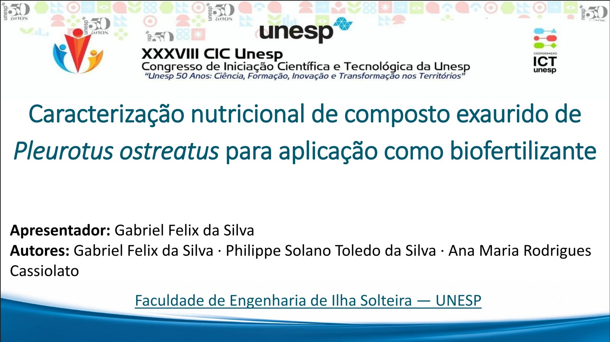

Nosso trabalho **"Caracterização nutricional de composto exaurido de *Pleurotus ostreatus* para aplicação como biofertilizante"** recebeu **menção honrosa** na 1ª fase do **XXXVIII Congresso de Iniciação Científica da Unesp (CIC)**. A etapa aconteceu em Ilha Solteira (SP), nos dias 23 e 24 de setembro de 2026. Com a menção, o trabalho foi **classificado para a 2ª fase** do evento.

O tema desta edição foi *Unesp 50 Anos: Ciência, Formação, Inovação e Transformação nos Territórios*.

## Sobre o trabalho

Depois da colheita do cogumelo-ostra, sobra um grande volume de substrato, o composto exaurido. Neste trabalho, analisamos a composição nutricional desse material para avaliar o seu uso como **biofertilizante**: um resíduo que volta ao campo como fonte de nutrientes para as plantas. Saiba mais na página do [projeto de pesquisa](/pesquisa/substrato-pleurotus/).

**Autores:** Gabriel Felix da Silva, Philippe Solano Toledo Silva e Ana Maria Rodrigues Cassiolato (FEIS/UNESP).

Agradeço à orientadora, aos colegas do Laboratório de Microbiologia da FEIS/UNESP e do DEFERS, e aos parceiros Funghi & Flora e Cogumelos Coloniais.
