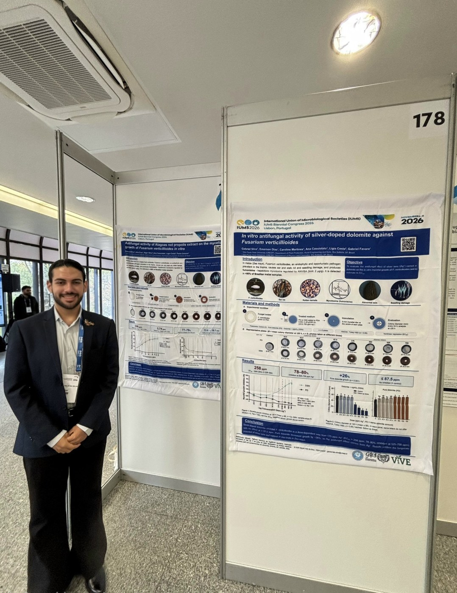

From 4 to 6 November 2026, the **Biennial Congress of the International Union of Microbiological Societies (IUMS 2026)** brought researchers from around the world to Lisbon under the theme *Beyond the Microscope: AI & Innovation in Microbiology*. These are highlights from the sessions I attended.

## Day 1 (4 November)

**Opening sessions (Auditorium I)**

- **Drew Weissman** (University of Pennsylvania), 2023 Nobel Prize in Physiology or Medicine: *Nucleoside-Modified mRNA-LNP Therapeutics*.
- **Joseph Heitman** (Duke University): *On the Evolution of Fungal Pathogenesis: Cryptococcus as a prism for discovery*.
- **Claudia Sala** (Fondazione Biotecnopolo di Siena): *Human monoclonal antibodies to tackle antibiotic-resistant bacteria*.

Heitman's lecture featured the World Health Organization fungal priority pathogens list, which includes ***Aspergillus fumigatus*** (critical group) and ***Fusarium* spp.** (high group), the two genera studied in our projects.

.")

**One Health (Auditorium III+IV)**

Oral presentations on antimicrobial resistance at the interface between people, animals and the environment, such as enterococcal resistance in households with companion animals and targets for broad-spectrum antivirals.

**Epidemiology and Public Health (Auditorium I)**

Genomic and metagenomic surveillance of outbreaks and emerging threats, closing with **Célia Manaia** (Universidade Católica Portuguesa): *Environmental Antimicrobial Resistance: Both Symptom and Risk*.

## Day 2 (5 November)

**Opening sessions (Auditorium I)**

- **Emmanuelle Charpentier** (Max Planck Unit for the Science of Pathogens), 2020 Nobel Prize in Chemistry: applications of CRISPR-Cas genome editing.
- **Wendy Barclay** (Imperial College London): *A host factor required for influenza virus replication could provide a target for novel approaches for control*.
- **Miguel Prudêncio** (GIMM, Lisbon): co-infections and the liver stage of malaria.

**Food Microbiology and Safety (Auditorium II)**

Non-conventional and brewing yeasts, *Ganoderma lucidum* nutraceuticals, fermented foods and feeds, coliphages in poultry and *Listeria monocytogenes* persistence in food production.

**Plant Pathogens and Human Well-being (Auditorium II)**

- **Pedro Crous** (Westerdijk Fungal Biodiversity Institute): *Polyphyly of Fusarium sensu Wollenweber*. Correct species identification is the first step in studying the control of pathogens such as *Fusarium verticillioides*. A useful public resource is the [Fusarioid-ID](https://www.fusarium.org) database.
- **Susanne Zeilinger** (Universität Innsbruck): *Chemical communication shapes fungal biocontrol: insights from Trichoderma atroviride*.
- **Julia Gallego Villanueva et al.** (University of Cádiz): MALDI-TOF for identifying fungal phytopathogen species and strains.

## Day 3 (6 November)

The final day placed artificial intelligence at the core of the programme. In the *AI's Global Impact* session, **Tiago Costa** (Imperial College London) presented *AI Recapitulates Experimental Discovery of a Novel Gene Transfer Mechanism*. The day also included sessions on *Big Data*, AI in clinical microbiology and One Health, and the panels *Will AI win?* and *Is data dead?*.

## Our posters (6 November)

On the final day, I presented our work in the poster session.

- **Silver-doped dolomite against *Fusarium verticillioides*** (session AS12): the composite inhibited the fungus in a dose-dependent way from 175 ppm Ag⁺ (EC₅₀ ≈ 258 ppm; 78–80% inhibition at 525–700 ppm). Pure dolomite did not inhibit the fungus, showing that the effect comes from silver. [View poster](/uploads/posters/IUMS2026_Poster_SilverDolomite_Fverticillioides.pdf)
- **Alagoas red propolis against *F. verticillioides*** (session AS12): the extract inhibited the fungus at every concentration tested (relative IC₅₀ 3.99–5.74 ppm), with maximum inhibition of about 78% from 75 ppm, in two independent assays. [View poster](/uploads/posters/IUMS2026_Poster_RedPropolis_Fverticillioides.pdf)
- **Microbial consortia and organic fertilization in *Astronium fraxinifolium* seedlings** (session AS18, led by Philippe Silva): composted sewage sludge was the main driver of seedling quality, and inoculation with *Bacillus subtilis* and *Rhizophagus clarus* increased root colonization and water use efficiency. [View poster](/uploads/posters/IUMS2026_Poster_MicrobialConsortia_Afraxinifolium.pdf)

Many thanks to the co-authors, advisors and research groups at FEIS/UNESP.

## What I take back to our research

Antimicrobial resistance and **One Health** ran through all three days. This is the same thread as our work on *Fusarium verticillioides* and *Aspergillus fumigatus*: finding alternatives to fungicides that protect crop production without increasing risks to human health. Our three studies presented at the congress are on the [Publications](/en/publications/) page.

*Photos of slides and talks were not reproduced, in line with the congress photography rules. Titles and speakers are listed in the official programme.*
