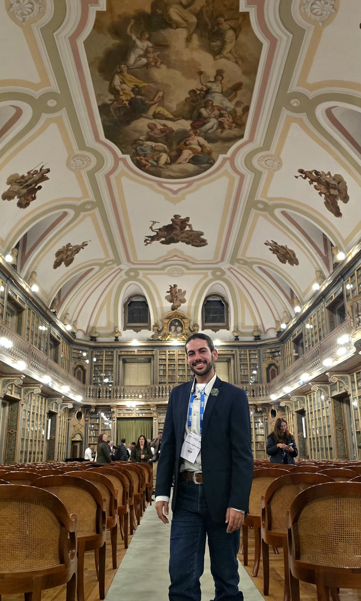
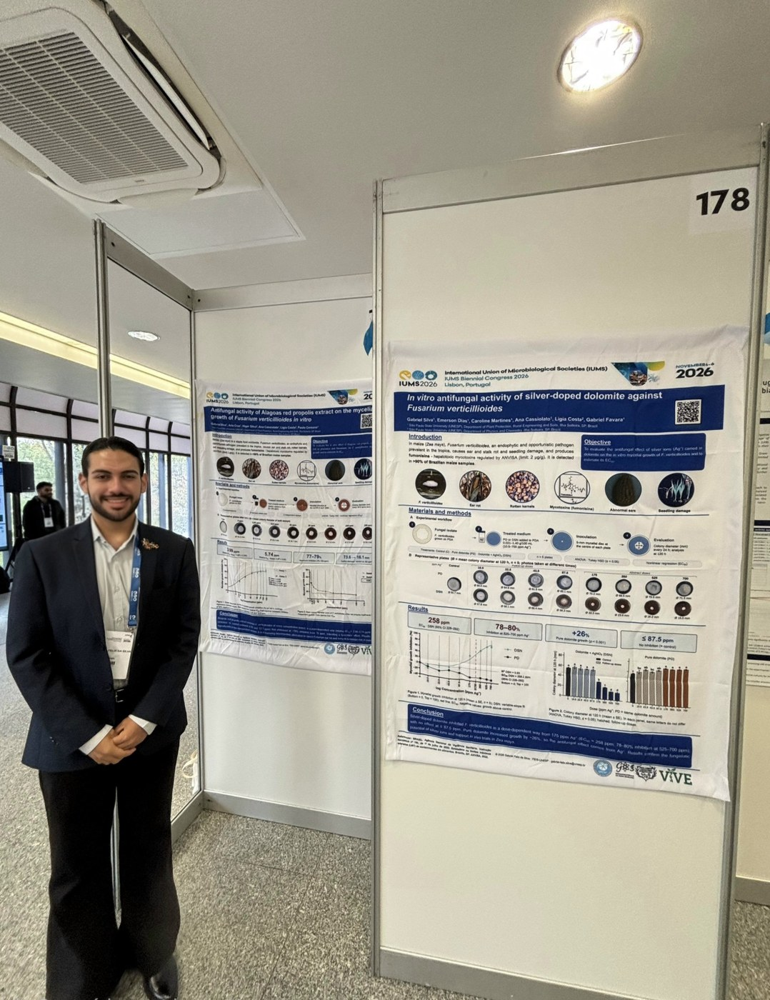

Del 4 al 6 de noviembre de 2026, el **Congreso Bienal de la International Union of Microbiological Societies (IUMS 2026)** reunió en Lisboa a investigadores de todo el mundo, con el tema *Beyond the Microscope: AI & Innovation in Microbiology*. Estos son los aspectos más destacados de las sesiones a las que asistí.

## Día 1 (4 de noviembre)

**Apertura (Auditorio I)**

- **Drew Weissman** (University of Pennsylvania), Premio Nobel de Fisiología o Medicina 2023: *Nucleoside-Modified mRNA-LNP Therapeutics*.
- **Joseph Heitman** (Duke University): *On the Evolution of Fungal Pathogenesis: Cryptococcus as a prism for discovery*.
- **Claudia Sala** (Fondazione Biotecnopolo di Siena): *Human monoclonal antibodies to tackle antibiotic-resistant bacteria*.

En la conferencia de Heitman se presentó la lista de hongos prioritarios de la Organización Mundial de la Salud, que incluye ***Aspergillus fumigatus*** (grupo crítico) y ***Fusarium* spp.** (grupo alto), los dos géneros estudiados en nuestros proyectos.

.")

**One Health (Auditorio III+IV)**

Comunicaciones orales sobre resistencia antimicrobiana en la interfaz entre personas, animales y ambiente, como la resistencia de enterococos en hogares con animales de compañía y dianas para antivirales de amplio espectro.

**Epidemiology and Public Health (Auditorio I)**

Vigilancia genómica y metagenómica de brotes y amenazas emergentes, con el cierre de **Célia Manaia** (Universidade Católica Portuguesa): *Environmental Antimicrobial Resistance: Both Symptom and Risk*.

## Día 2 (5 de noviembre)

**Apertura (Auditorio I)**

- **Emmanuelle Charpentier** (Max Planck Unit for the Science of Pathogens), Premio Nobel de Química 2020: aplicaciones de la edición genómica CRISPR-Cas.
- **Wendy Barclay** (Imperial College London): *A host factor required for influenza virus replication could provide a target for novel approaches for control*.
- **Miguel Prudêncio** (GIMM, Lisboa): coinfecciones y la fase hepática de la malaria.

**Food Microbiology and Safety (Auditorio II)**

Levaduras no convencionales y cerveceras, nutracéuticos de *Ganoderma lucidum*, alimentos y piensos fermentados, colifagos en avicultura y la persistencia de *Listeria monocytogenes* en la industria alimentaria.

**Plant Pathogens and Human Well-being (Auditorio II)**

- **Pedro Crous** (Westerdijk Fungal Biodiversity Institute): *Polyphyly of Fusarium sensu Wollenweber*. La identificación correcta de la especie es el primer paso para estudiar el control de patógenos como *Fusarium verticillioides*. Un recurso público útil es la base [Fusarioid-ID](https://www.fusarium.org).
- **Susanne Zeilinger** (Universität Innsbruck): *Chemical communication shapes fungal biocontrol: insights from Trichoderma atroviride*.
- **Julia Gallego Villanueva et al.** (Universidad de Cádiz): MALDI-TOF para identificar especies y cepas de hongos fitopatógenos.

## Una noche en la Academia de Ciencias de Lisboa (5 de noviembre)

Al final del segundo día, el programa social reunió a los participantes en el Largo Luís de Camões, en el Chiado, para una caminata hasta la [Academia de Ciencias de Lisboa](https://www.acad-ciencias.pt/). Fundada en 1779, la Academia funciona desde 1834 en el antiguo Convento de Jesús. La noche terminó con fado en el Salão Nobre, entre las estanterías de la antigua biblioteca del convento.

El lema de la Academia resume bien el propósito de la divulgación científica: *Nisi utile est quod facimus, stulta est gloria* ("Si lo que hacemos no es útil, la gloria es vana").

## Día 3 (6 de noviembre)

El último día situó la inteligencia artificial en el centro del programa. En la sesión *AI's Global Impact*, **Tiago Costa** (Imperial College London) presentó *AI Recapitulates Experimental Discovery of a Novel Gene Transfer Mechanism*. La jornada incluyó además sesiones de *Big Data*, de IA en microbiología clínica y Una Salud, y los paneles *Will AI win?* e *Is data dead?*.

## Nuestros pósteres (6 de noviembre)

El último día presenté nuestros trabajos en la sesión de pósteres.

- **Dolomita dopada con plata contra *Fusarium verticillioides*** (sesión AS12): el compuesto inhibió el hongo de forma dosis-dependiente a partir de 175 ppm de Ag⁺ (CE₅₀ ≈ 258 ppm; 78–80% de inhibición con 525–700 ppm). La dolomita pura no inhibió el hongo, lo que muestra que el efecto proviene de la plata. [Ver póster](/uploads/posters/IUMS2026_Poster_SilverDolomite_Fverticillioides.pdf)
- **Propóleo rojo de Alagoas contra *F. verticillioides*** (sesión AS12): el extracto inhibió el hongo en todas las concentraciones probadas (CI₅₀ relativa de 3,99–5,74 ppm), con una inhibición máxima de alrededor del 78% a partir de 75 ppm, en dos ensayos independientes. [Ver póster](/uploads/posters/IUMS2026_Poster_RedPropolis_Fverticillioides.pdf)
- **Consorcios microbianos y fertilización orgánica en plántulas de *Astronium fraxinifolium*** (sesión AS18, liderado por Philippe Silva): el lodo de depuradora compostado fue el principal factor de calidad de las plántulas, y la inoculación con *Bacillus subtilis* y *Rhizophagus clarus* aumentó la colonización radicular y la eficiencia en el uso del agua. [Ver póster](/uploads/posters/IUMS2026_Poster_MicrobialConsortia_Afraxinifolium.pdf)

Agradezco a los coautores, a las orientadoras y a los grupos de investigación de la FEIS/UNESP.

## Lo que llevo a nuestra investigación

La resistencia antimicrobiana y **Una Salud** atravesaron los tres días. Es el mismo eje de nuestros trabajos con *Fusarium verticillioides* y *Aspergillus fumigatus*: buscar alternativas a los fungicidas que protejan la producción agrícola sin aumentar los riesgos para la salud humana. Los tres trabajos que llevamos al congreso están en la página de [Publicaciones](/es/publicaciones/).

*No se reprodujeron fotos de diapositivas ni de presentaciones, de acuerdo con las normas de fotografía del congreso. Los títulos y ponentes figuran en el programa oficial.*
