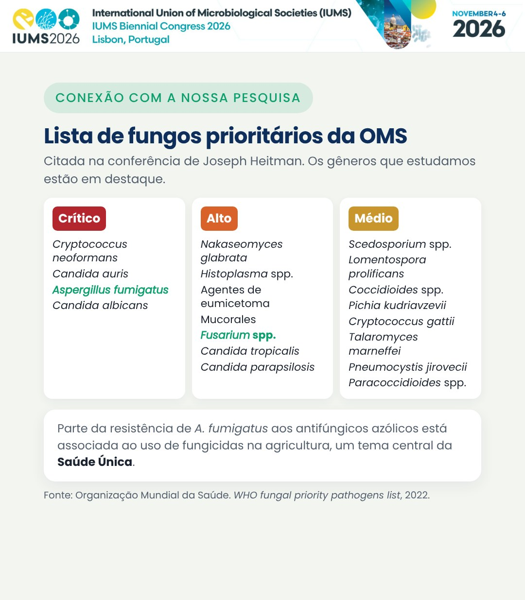

De 4 a 6 de novembro de 2026, o **Congresso Bienal da International Union of Microbiological Societies (IUMS 2026)** reuniu pesquisadores de todo o mundo em Lisboa, com o tema *Beyond the Microscope: AI & Innovation in Microbiology*. Seguem os destaques das sessões que acompanhei.

## Dia 1 (4 de novembro)

**Abertura (Auditório I)**

- **Drew Weissman** (University of Pennsylvania), Prêmio Nobel de Fisiologia ou Medicina de 2023: *Nucleoside-Modified mRNA-LNP Therapeutics*.
- **Joseph Heitman** (Duke University): *On the Evolution of Fungal Pathogenesis: Cryptococcus as a prism for discovery*.
- **Claudia Sala** (Fondazione Biotecnopolo di Siena): *Human monoclonal antibodies to tackle antibiotic-resistant bacteria*.

Na conferência de Heitman, a lista de fungos prioritários da Organização Mundial da Saúde chamou atenção: ela inclui ***Aspergillus fumigatus*** (grupo crítico) e ***Fusarium* spp.** (grupo alto), os dois gêneros estudados nos nossos projetos.

**One Health (Auditório III+IV)**

Comunicações orais sobre resistência antimicrobiana na interface entre pessoas, animais e ambiente, como a resistência de enterococos em lares com animais de companhia e alvos para antivirais de amplo espectro.

**Epidemiology and Public Health (Auditório I)**

Vigilância genômica e metagenômica de surtos e de ameaças emergentes, com encerramento de **Célia Manaia** (Universidade Católica Portuguesa): *Environmental Antimicrobial Resistance: Both Symptom and Risk*.

## Dia 2 (5 de novembro)

**Abertura (Auditório I)**

- **Emmanuelle Charpentier** (Max Planck Unit for the Science of Pathogens), Prêmio Nobel de Química de 2020: aplicações da edição genômica CRISPR-Cas.
- **Wendy Barclay** (Imperial College London): *A host factor required for influenza virus replication could provide a target for novel approaches for control*.
- **Miguel Prudêncio** (GIMM, Lisboa): coinfecções e a fase hepática da malária.

**Food Microbiology and Safety (Auditório II)**

Leveduras não convencionais e cervejeiras, nutracêuticos de *Ganoderma lucidum*, alimentos e rações fermentados, colifagos na avicultura e a persistência de *Listeria monocytogenes* na indústria de alimentos.

**Plant Pathogens and Human Well-being (Auditório II)**

- **Pedro Crous** (Westerdijk Fungal Biodiversity Institute): *Polyphyly of Fusarium sensu Wollenweber*. A identificação correta da espécie é o primeiro passo para estudar o controle de patógenos como *Fusarium verticillioides*. Um recurso público útil é a base [Fusarioid-ID](https://www.fusarium.org).
- **Susanne Zeilinger** (Universität Innsbruck): *Chemical communication shapes fungal biocontrol: insights from Trichoderma atroviride*.
- **Julia Gallego Villanueva et al.** (Universidad de Cádiz): MALDI-TOF para identificar espécies e linhagens de fungos fitopatogênicos.

## Dia 3 (6 de novembro)

O último dia teve a inteligência artificial no centro da programação. Na sessão *AI's Global Impact*, **Tiago Costa** (Imperial College London) apresentou *AI Recapitulates Experimental Discovery of a Novel Gene Transfer Mechanism*. A programação incluiu ainda sessões de *Big Data*, de IA na microbiologia clínica e na Saúde Única, e os painéis *Will AI win?* e *Is data dead?*.

## O que levo para a nossa pesquisa

A resistência antimicrobiana e a **Saúde Única** atravessaram os três dias. Esse é o mesmo eixo dos nossos trabalhos com *Fusarium verticillioides* e *Aspergillus fumigatus*: buscar alternativas aos fungicidas que protejam a produção agrícola sem ampliar riscos à saúde humana. Os três trabalhos que levamos ao congresso estão na página de [Publicações](/publicacoes/).

*As fotos de slides e apresentações não foram reproduzidas, conforme as regras de fotografia do congresso. Títulos e palestrantes constam do programa oficial.*
