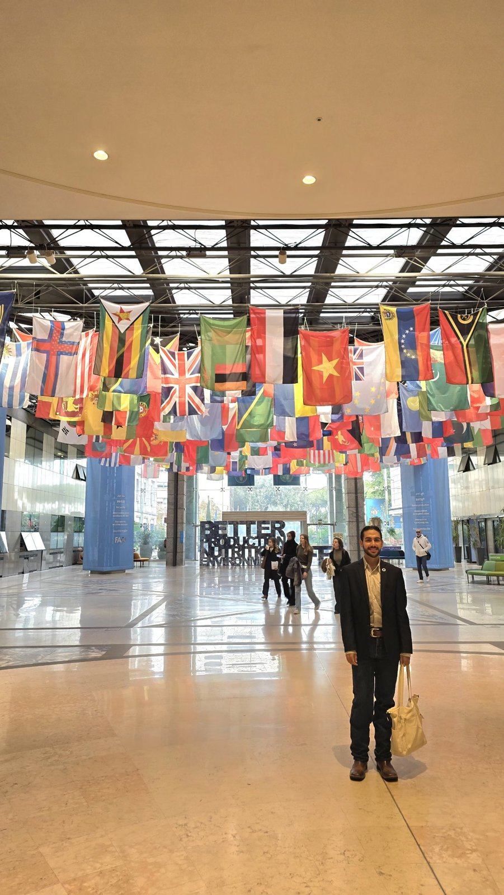
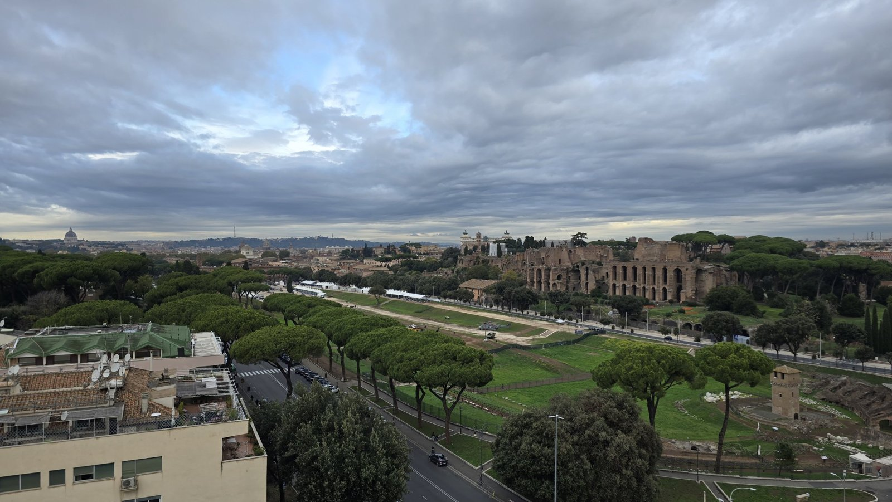

On **9 November 2026**, at the invitation of **Jorge Pinto Ferreira**, food safety specialist at FAO, I visited the headquarters of the [Food and Agriculture Organization of the United Nations (FAO)](https://www.fao.org/home/en) in Rome. The visit was led by **Dr. Kang Zhou**, Food Safety Officer at FAO, who works on scientific advice for food safety.

## What we saw

The presentation covered FAO's mission, how the organization is structured and how its technical areas work together to support countries in fighting hunger, ensuring food safety and transforming agrifood systems.

In the hall, the Preamble to the Constitution of FAO, engraved in marble in several languages, recalls the ultimate objective of all its activities: **ensuring humanity's freedom from hunger**.

## Why it matters for our research

Fungi such as *Fusarium verticillioides*, which we study at FEIS/UNESP, affect both food production and the health of consumers, through mycotoxins such as fumonisins. Seeing how science reaches global decisions about food reinforces the **One Health** approach, which connects the health of plants, people and the environment.

My thanks to Jorge Pinto Ferreira for the invitation and to Dr. Kang Zhou for the welcome and the presentation.
