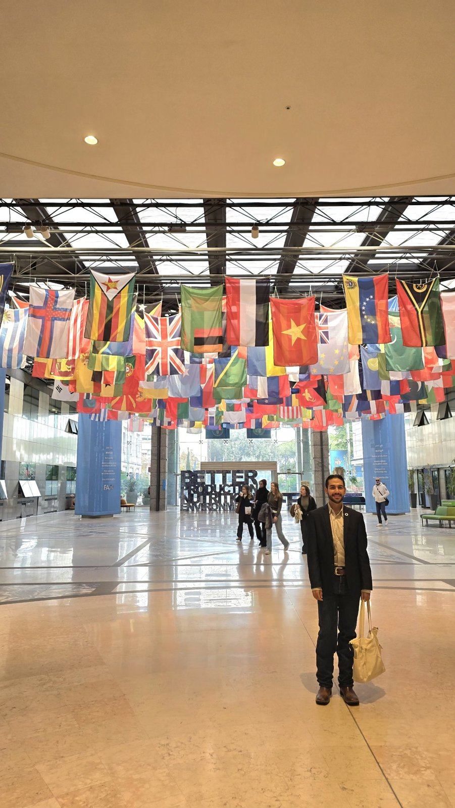
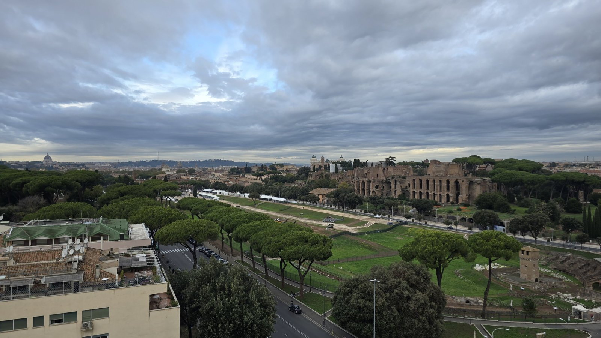

El **9 de noviembre de 2026**, por invitación de **Jorge Pinto Ferreira**, especialista en inocuidad de los alimentos de la FAO, visité la sede de la [Organización de las Naciones Unidas para la Alimentación y la Agricultura (FAO)](https://www.fao.org/home/es), en Roma. La visita estuvo a cargo del **Dr. Kang Zhou**, *Food Safety Officer* de la FAO, que trabaja en el asesoramiento científico sobre inocuidad de los alimentos.

## Lo que vimos

En la presentación conocimos la misión de la FAO, cómo está estructurada la organización y cómo sus áreas técnicas se articulan para apoyar a los países en la lucha contra el hambre, la inocuidad de los alimentos y la transformación de los sistemas agroalimentarios.

En el vestíbulo, el preámbulo de la Constitución de la FAO, grabado en mármol en varios idiomas, recuerda el objetivo final de todas sus actividades: **liberar a la humanidad del hambre**.

## Por qué importa para nuestra investigación

Hongos como *Fusarium verticillioides*, que estudiamos en la FEIS/UNESP, afectan al mismo tiempo la producción de alimentos y la salud de quienes los consumen, a través de micotoxinas como las fumonisinas. Ver de cerca cómo la ciencia llega a las decisiones globales sobre alimentos refuerza el enfoque de **Una Salud**, que une la salud de las plantas, de las personas y del ambiente.

Agradezco a Jorge Pinto Ferreira por la invitación y al Dr. Kang Zhou por la recepción y la presentación.
