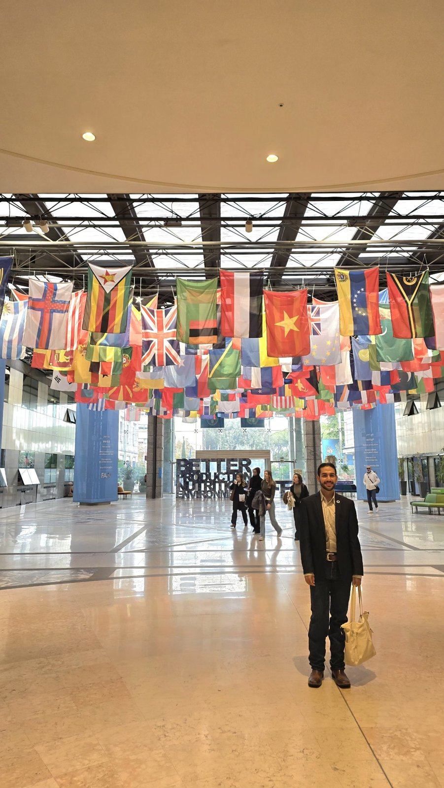
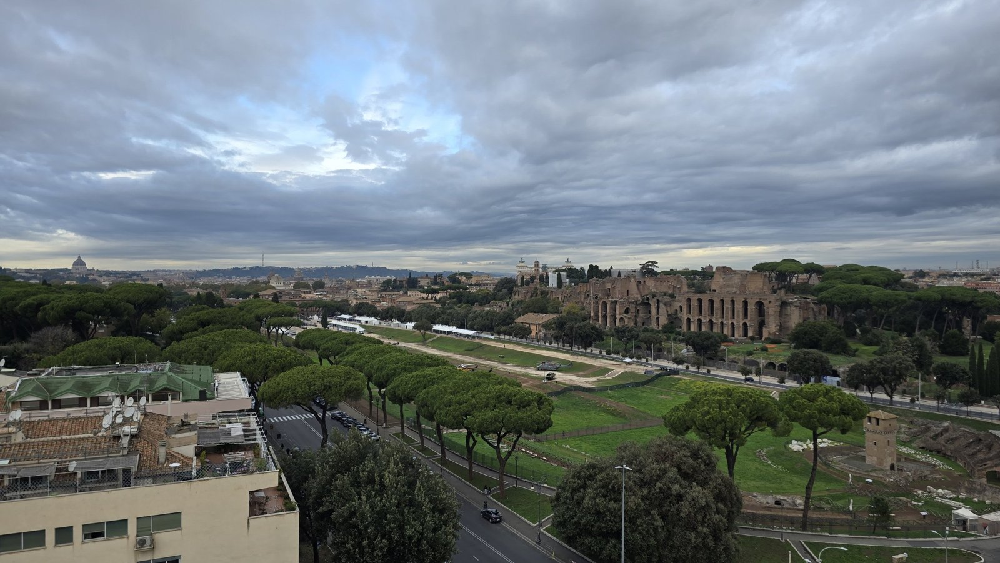

No dia **9 de novembro de 2026**, a convite de **Jorge Pinto Ferreira**, especialista em segurança dos alimentos da FAO, visitei a sede da [Organização das Nações Unidas para a Alimentação e a Agricultura (FAO)](https://www.fao.org/home/pt), em Roma. A visita foi conduzida pelo **Dr. Kang Zhou**, *Food Safety Officer* da FAO, que trabalha no aconselhamento científico em segurança dos alimentos.

## O que vimos

Na apresentação, conhecemos a missão da FAO, a forma como a organização está estruturada e como suas áreas técnicas se articulam para apoiar os países no combate à fome, na segurança dos alimentos e na transformação dos sistemas agroalimentares.

No hall, o preâmbulo da Constituição da FAO, gravado em mármore em vários idiomas, lembra o objetivo final de todas as suas atividades: **garantir que a humanidade esteja livre da fome**.

## Por que isso importa para a nossa pesquisa

Fungos como *Fusarium verticillioides*, que estudamos na FEIS/UNESP, afetam ao mesmo tempo a produção de alimentos e a saúde de quem os consome, por meio de micotoxinas como as fumonisinas. Ver de perto como a ciência chega às decisões globais sobre alimentos reforça a abordagem de **Saúde Única**, que liga a saúde das plantas, das pessoas e do ambiente.

Agradeço a Jorge Pinto Ferreira pelo convite e ao Dr. Kang Zhou pela recepção e pela apresentação.
