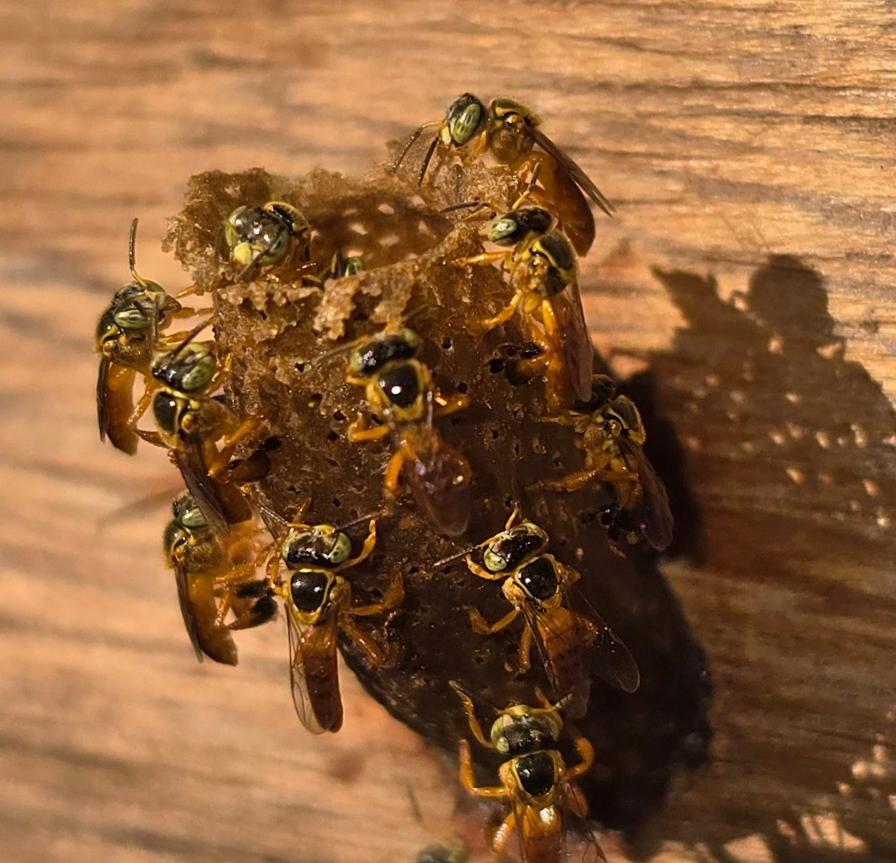
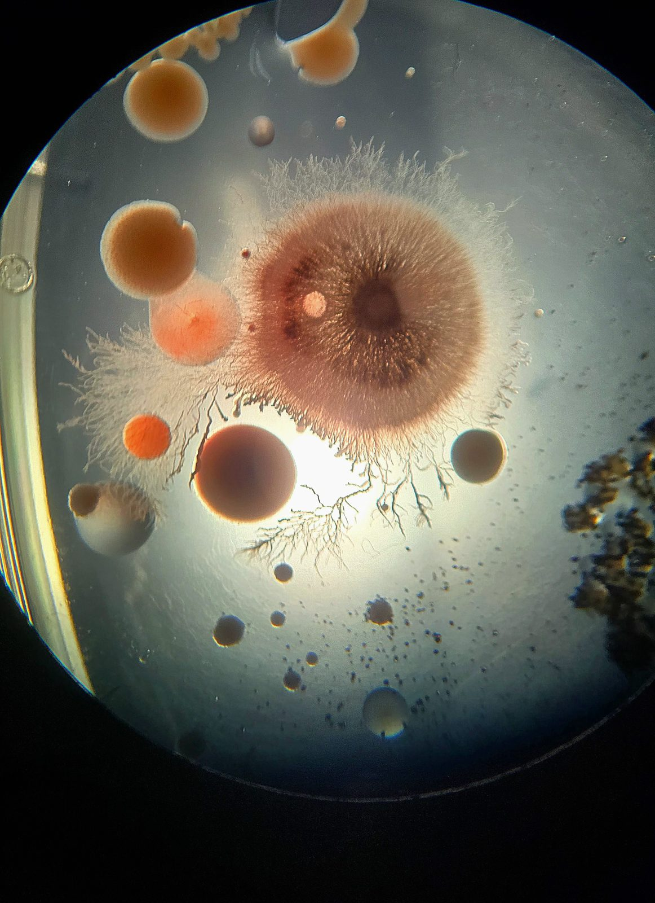

The jataí (*Tetragonisca angustula*) is a native stingless bee, important for pollination and
producer of a highly valued honey.

This research line covers the **characterization of jataí honey**, including microbiological
analyses, and **monitoring of hive temperature**.

## Research photos

.")

The results were presented at the **33rd Brazilian Congress of Microbiology (CBM)** in Aracaju, in October 2025. In honey samples from five boxes at FEIS/UNESP, mean counts were 1.48 × 10⁴ CFU g⁻¹ for bacteria and yeasts and 5.82 × 10² CFU g⁻¹ for filamentous fungi.

.")

[View the full poster (PDF)](/uploads/posters/CBM2025_Poster_MelJatai_Tetragonisca.pdf)
