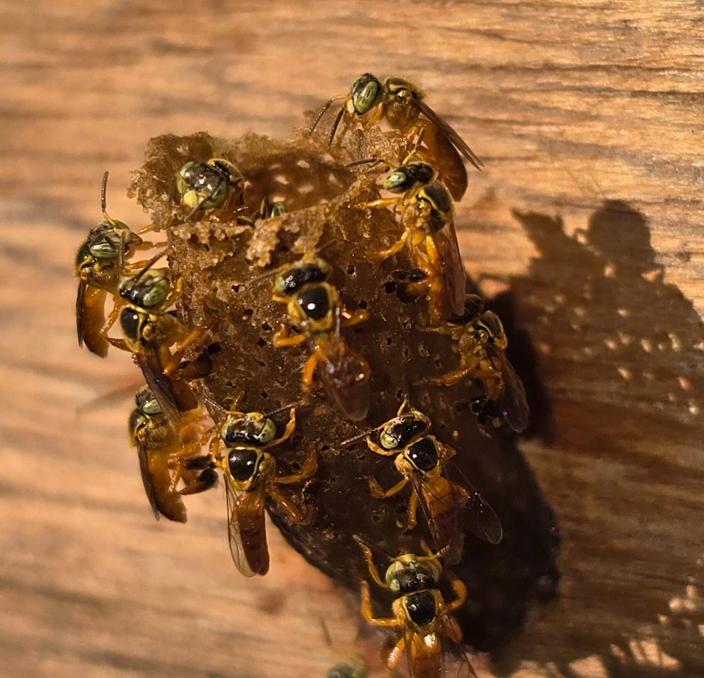
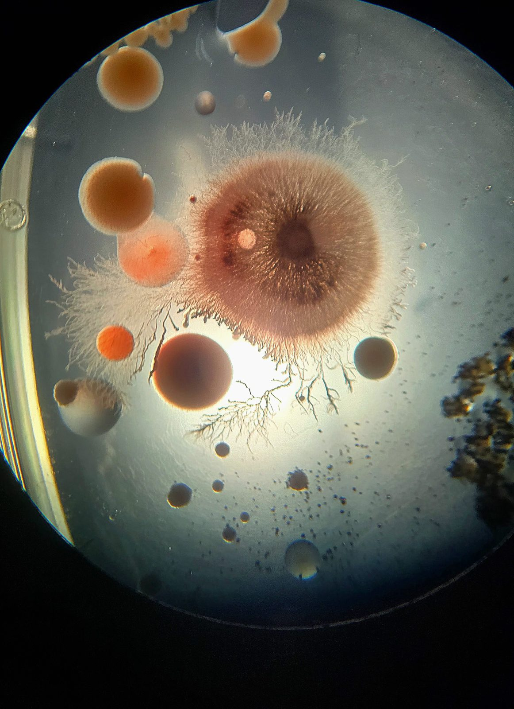

La jataí (*Tetragonisca angustula*) es una abeja sin aguijón nativa, importante para la
polinización y productora de una miel muy valorada.

Esta línea de investigación reúne la **caracterización de la miel de jataí**, incluidas evaluaciones
microbiológicas, y el **monitoreo de la temperatura de las colmenas**.

## Fotos de la investigación

.")

Los resultados se presentaron en el **33.º Congreso Brasileño de Microbiología (CBM)**, en Aracaju, en octubre de 2025. En las muestras de miel de cinco cajas de la FEIS/UNESP, los recuentos medios fueron de 1,48 × 10⁴ UFC g⁻¹ para bacterias y levaduras y de 5,82 × 10² UFC g⁻¹ para hongos filamentosos.

.")

[Ver el póster completo (PDF)](/uploads/posters/CBM2025_Poster_MelJatai_Tetragonisca.pdf)
