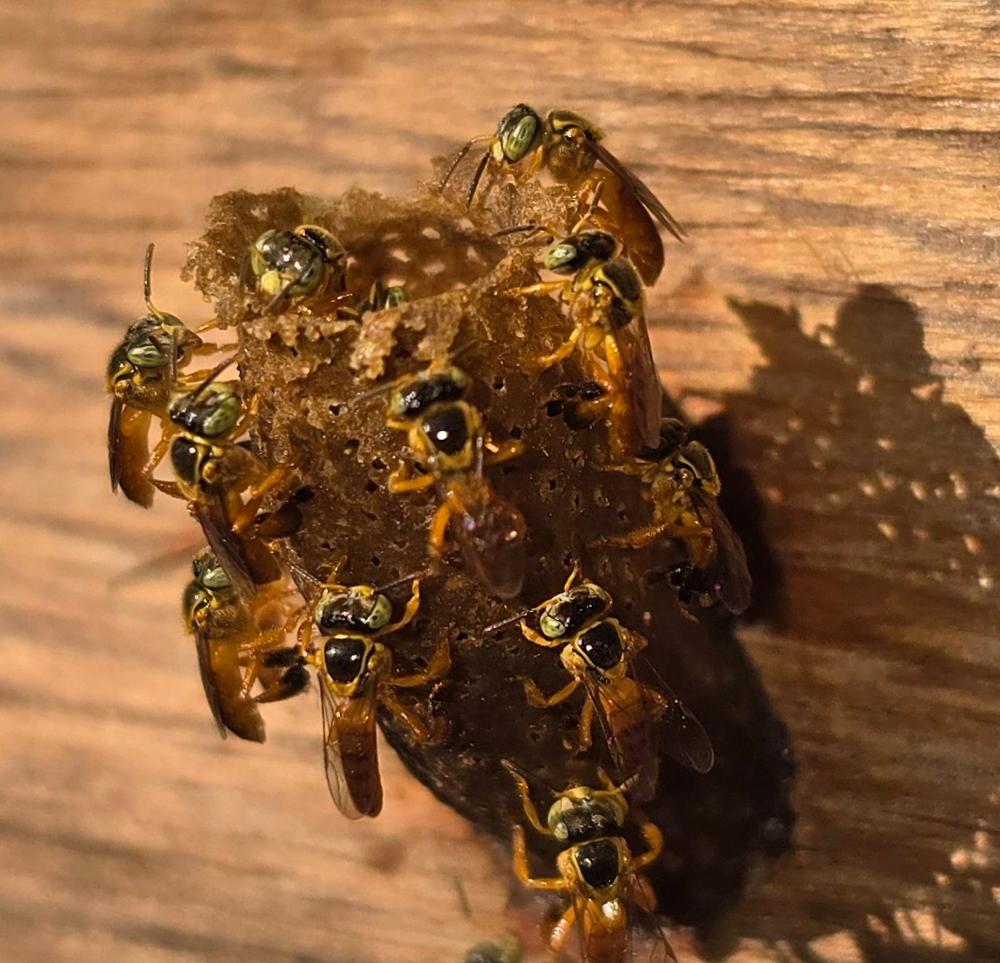
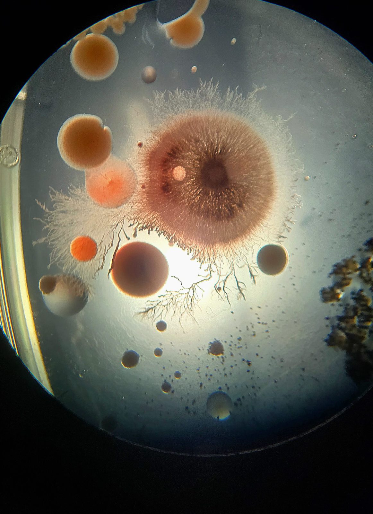

A jataí (*Tetragonisca angustula*) é uma abelha sem ferrão nativa, importante para a
polinização e produtora de um mel muito valorizado.

Esta linha de pesquisa reúne a **caracterização do mel de jataí**, incluindo avaliações
microbiológicas, e o **monitoramento da temperatura das colmeias**.

## Fotos da pesquisa

.")

Os resultados foram apresentados no **33º Congresso Brasileiro de Microbiologia (CBM)**, em Aracaju, em outubro de 2025. Nas amostras de mel de cinco caixas da FEIS/UNESP, as contagens médias foram de 1,48 × 10⁴ UFC g⁻¹ para bactérias e leveduras e de 5,82 × 10² UFC g⁻¹ para fungos filamentosos.

.")
