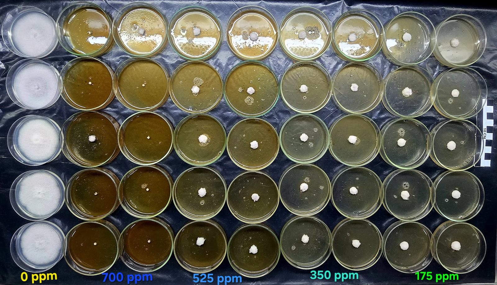
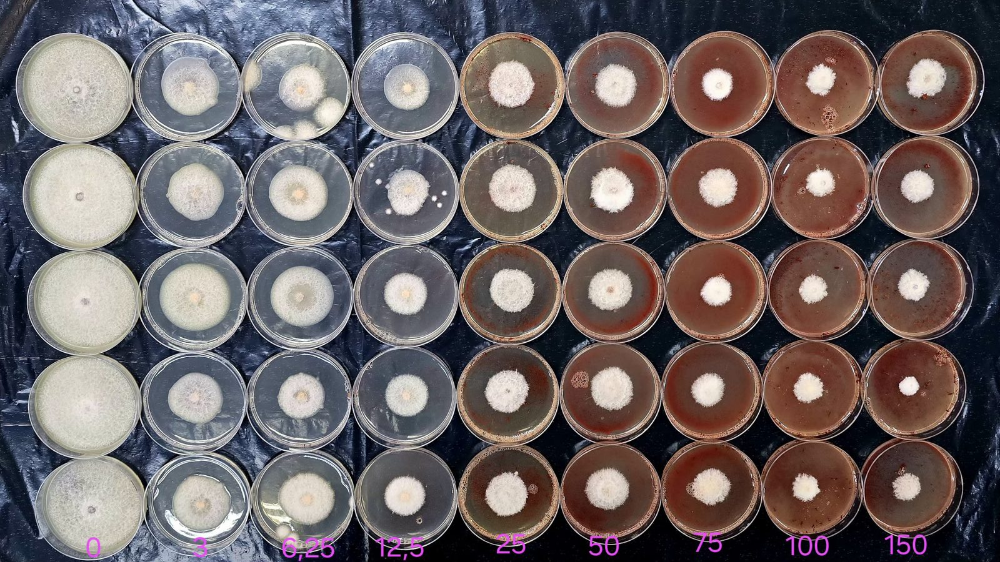
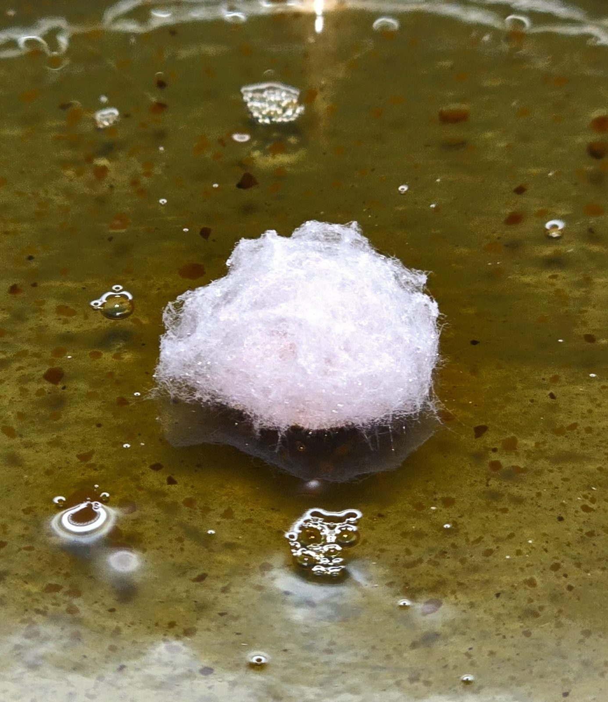

Emerging plant pathogens are described as pathogens that: (i) have been recently discovered or described; (ii) have recently evolved; (iii) have increased in incidence, expanded geographically or broadened their host range; and (iv) have changed their pathogenic properties. An emerging pathogen may be a new virus, bacterium or fungus with the potential to become endemic, epidemic or even pandemic. Plant-pathogenic fungi, in particular, are known to cause high yield losses in agricultural crops, with consequent economic impact, and devastating new fungal diseases are constantly emerging in agroecosystems. South American agriculture is particularly vulnerable to the emergence of plant pathogens. Because our understanding of the risk of pathogen emergence in agroecosystems is still limited, strategies for monitoring, surveillance and risk prediction must be developed.

## Research photos

In the *in vitro* assays, the fungus grows on plates with culture medium containing increasing doses of the tested material. By measuring colony diameter, we calculate how much each dose inhibits growth.

: the fungus grows normally at all doses.")

.")
