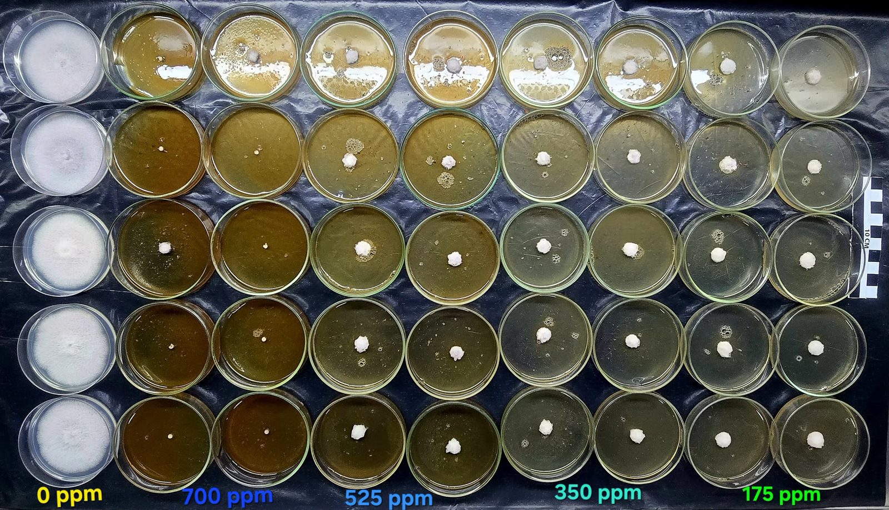
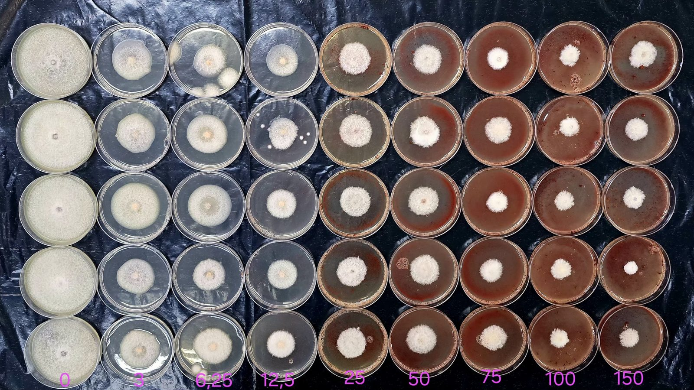
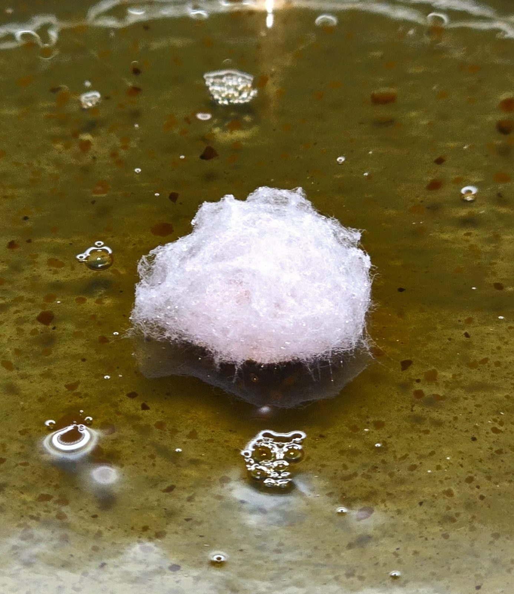

Los fitopatógenos emergentes se describen como patógenos que: (i) han sido descubiertos o descritos recientemente; (ii) han evolucionado recientemente; (iii) han aumentado su incidencia, se han expandido geográficamente o han ampliado su gama de hospederos; y (iv) han cambiado sus propiedades patogénicas. Un patógeno emergente puede ser un nuevo virus, bacteria u hongo con potencial para volverse endémico, epidémico e incluso pandémico. Los hongos fitopatógenos, en particular, son conocidos por causar grandes pérdidas de rendimiento en los cultivos agrícolas, con el consiguiente impacto económico, y nuevas enfermedades fúngicas devastadoras surgen constantemente en los agroecosistemas. La agricultura sudamericana es especialmente vulnerable a la emergencia de fitopatógenos. Como nuestra comprensión del riesgo de emergencia de fitopatógenos en los agroecosistemas aún es limitada, es necesario desarrollar estrategias de monitoreo, vigilancia y predicción de ese riesgo.

## Fotos de la investigación

En los ensayos *in vitro*, el hongo crece en placas con medio de cultivo que recibe dosis crecientes del material evaluado. Midiendo el diámetro de las colonias, calculamos cuánto inhibe el crecimiento cada dosis.

: el hongo crece normalmente en todas las dosis.")

.")
