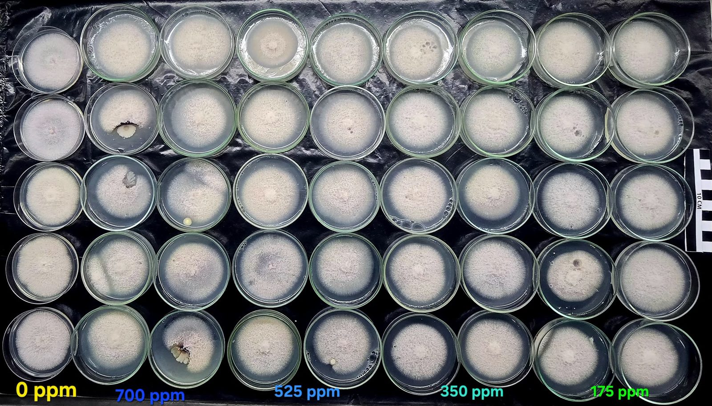
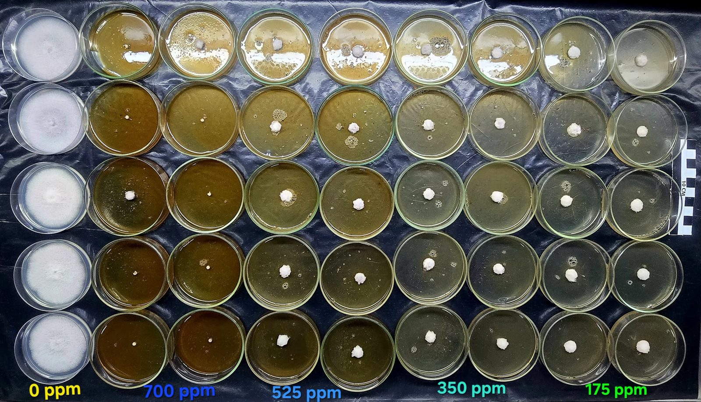
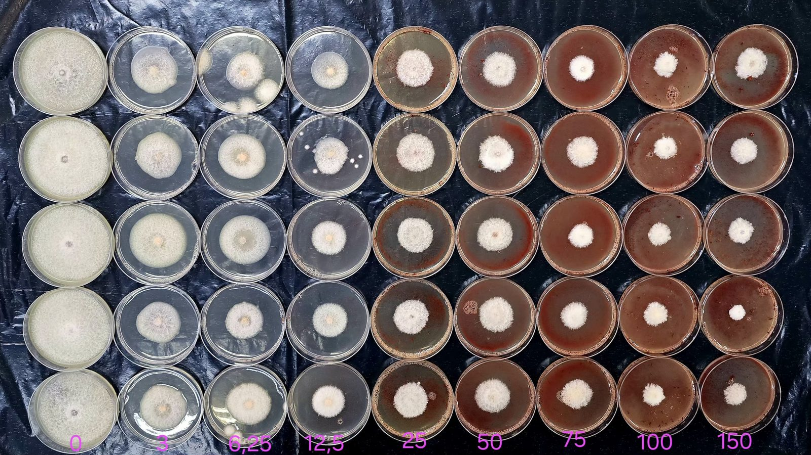
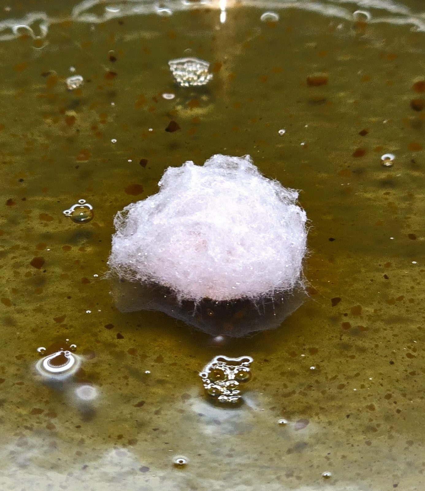

Fitopatógenos emergentes são descritos como patógenos que: (i) foram récem descobertos ou descritos; (ii) evoluíram recentemente; (iii) aumentaram em incidência, expandiram geograficamente ou quanto à sua gama de hospedeiros; e (iv) tiveram alterações em suas propriedades patogênicas. Um patógeno emergente pode ser um novo vírus, bactéria ou fungo que tem o potencial para se tornar endêmico, epidêmico e até mesmo adquirir natureza pandêmica. Fungos fitopatogênicos, em particular, são conhecidos por causarem perdas elevadas de rendimento nas culturas agrícolas com conseqüente impacto na economia, e novas doenças fúngicas devastadoras estão constantemente emergindo nos agroecossistemas. A agricultura sul americana está particularmente vulnerável à emergência de fitopatógenos. Como nossa compreensão do risco da emergência de fitopatógenos nos agroecossistemas ainda é pobre, é necessário que estratégias de monitoramento, vigilância e previsão do risco de emergência sejam desenvolvidas.

## Fotos da pesquisa

Nos ensaios *in vitro*, o fungo cresce em placas com meio de cultura que recebe doses crescentes do material testado. Medindo o diâmetro das colônias, calculamos quanto cada dose inibe o crescimento.

.")
