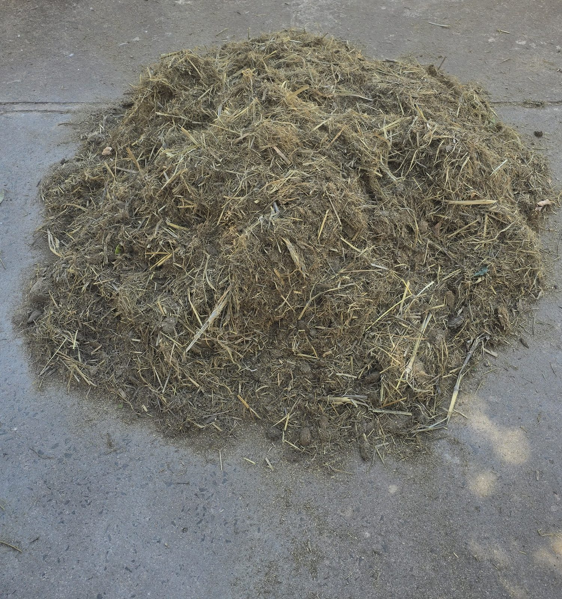
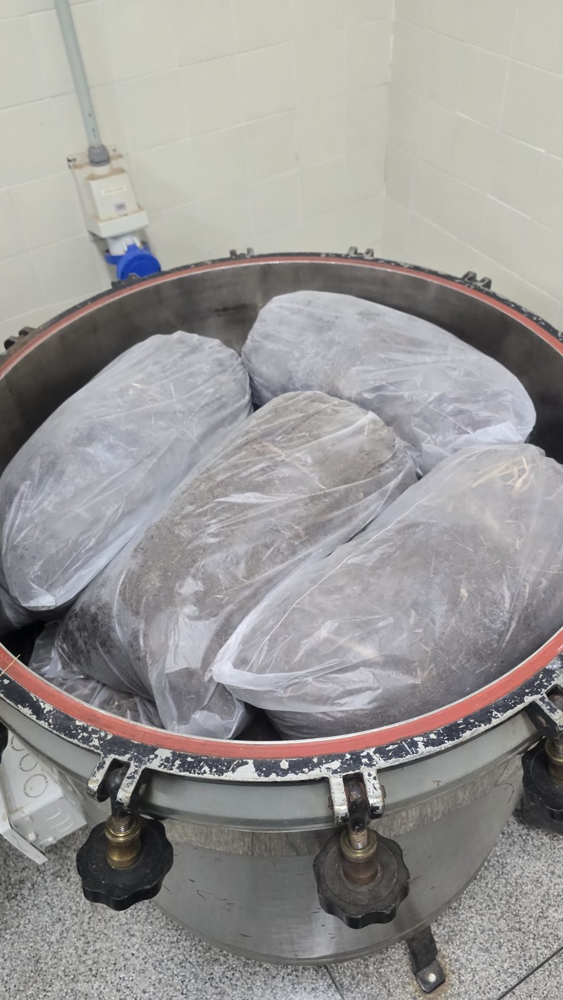
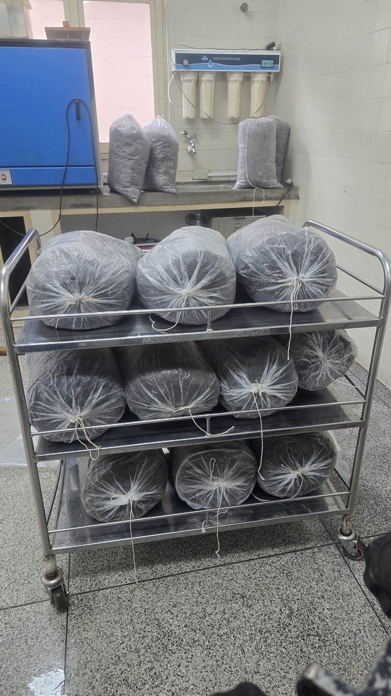
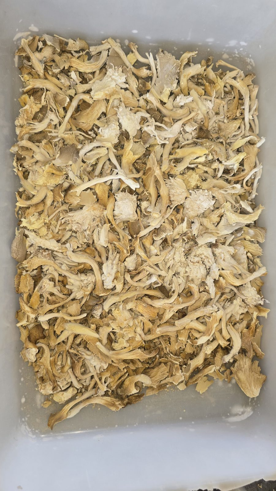

After the oyster mushroom (*Pleurotus ostreatus*) harvest, a large volume of substrate is left over
and is usually discarded. This project, which is also my undergraduate thesis, evaluates the
nutritional composition of this **spent mushroom substrate** in different formulations, to find out
whether it can return to the field as a **biofertilizer**.

**What we investigate**

- Macro- and micronutrient contents of the substrate under different treatments;
- The relationship between substrate formulation and mushroom yield;
- The potential agricultural use of the material, closing the production cycle.

The first results are part of a paper for CIC 2026.

## From substrate to mushroom

## Mushroom proteins

In a parallel line, we evaluated fresh papaya latex (*Carica papaya*), rich in the enzyme papain, to extract proteins from oyster mushrooms. The work was presented at the **33rd Brazilian Congress of Microbiology (CBM)** in 2025.

.")
