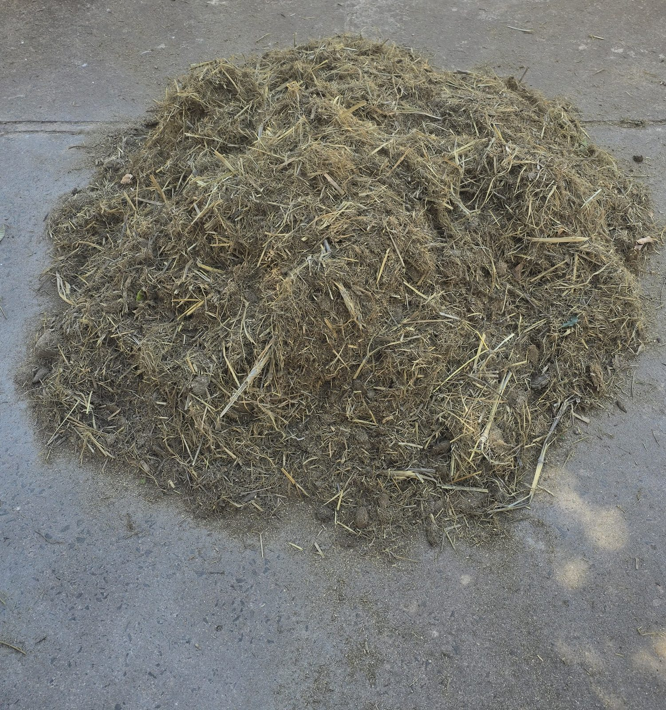
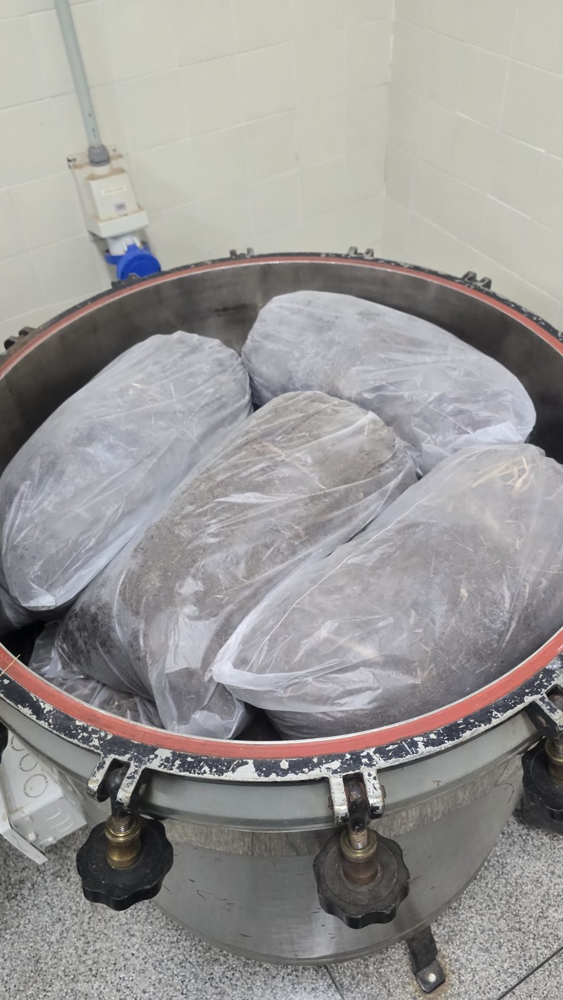
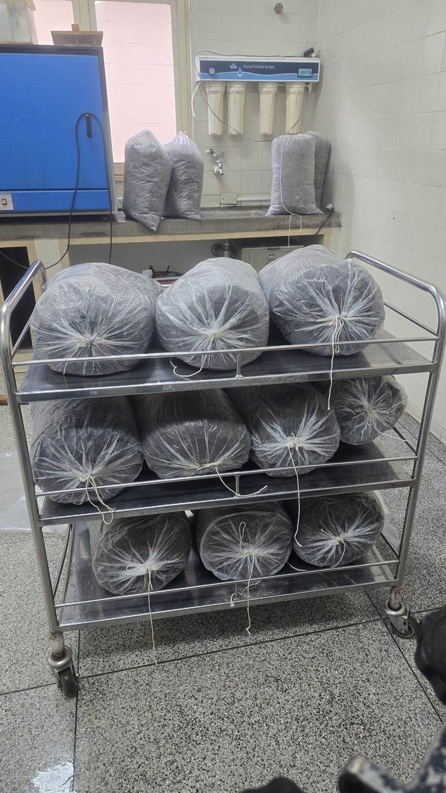
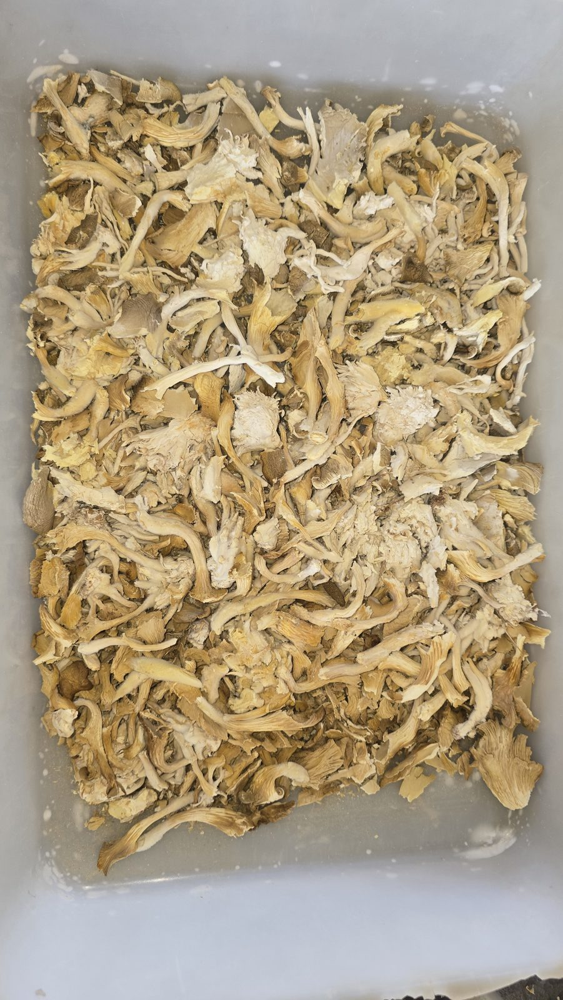

Después de la cosecha de la gírgola (*Pleurotus ostreatus*), queda un gran volumen de sustrato que
suele desecharse. Este proyecto, que también es mi Trabajo de Conclusión de Curso, evalúa la
composición nutricional de este **sustrato poscultivo** (*spent mushroom substrate*) en diferentes
formulaciones, para saber si puede volver al campo como **biofertilizante**.

**Qué investigamos**

- Contenidos de macro y micronutrientes del sustrato en diferentes tratamientos;
- La relación entre la formulación del sustrato y la productividad del hongo;
- El potencial de uso agrícola del material, cerrando el ciclo de producción.

Los primeros resultados forman parte de un trabajo para el CIC 2026.

## Del sustrato a la seta

## Proteínas de la seta

En una línea paralela, evaluamos el látex fresco de papaya (*Carica papaya*), rico en la enzima papaína, para extraer proteínas de la seta ostra. El trabajo se presentó en el **33.º Congreso Brasileño de Microbiología (CBM)**, en 2025.

.")
