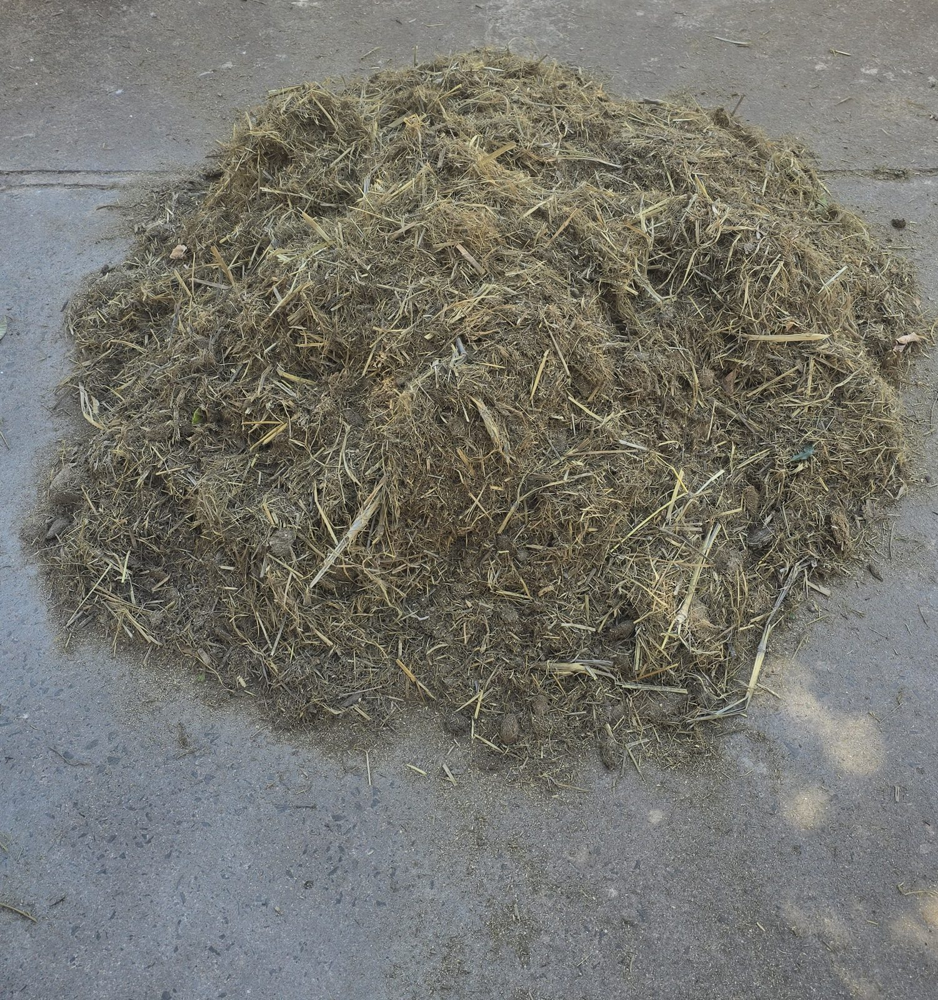
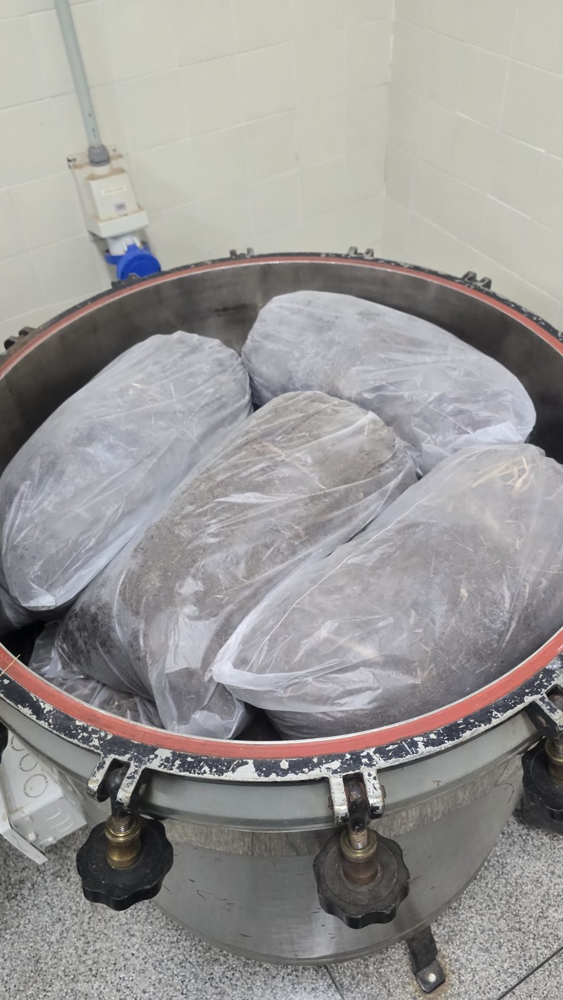
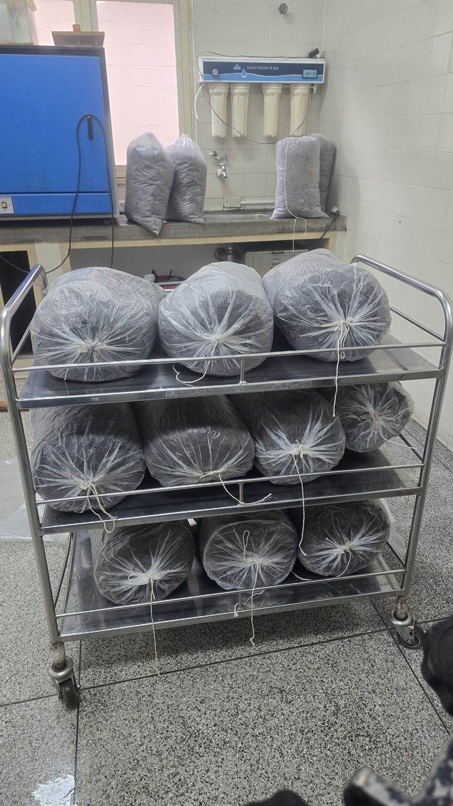
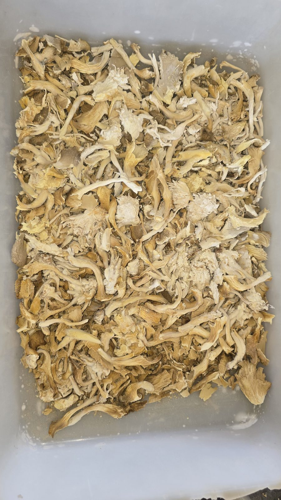

Depois da colheita do cogumelo-ostra (*Pleurotus ostreatus*), sobra um grande volume de substrato
que costuma ser descartado. Este projeto, que é também o meu Trabalho de Conclusão de Curso,
avalia a composição nutricional desse **substrato pós-cultivo** (*spent mushroom substrate*) em
diferentes formulações, para entender se ele pode voltar ao campo como **biofertilizante**.

**O que investigamos**

- Teores de macro e micronutrientes do substrato em diferentes tratamentos;
- Relação entre a formulação do substrato e a produtividade do cogumelo;
- Potencial de uso agrícola do material, fechando o ciclo da produção.

Os primeiros resultados compõem um trabalho no CIC 2026.

## Do substrato ao cogumelo

## Proteínas do cogumelo

Em uma linha paralela, avaliamos o látex fresco de mamão (*Carica papaya*), rico na enzima papaína, para extrair proteínas do cogumelo-ostra. O trabalho foi apresentado no **33º Congresso Brasileiro de Microbiologia (CBM)**, em 2025.

.")

[Ver o pôster completo (PDF)](/uploads/posters/CBM2025_Poster_Papaina_Pleurotus.pdf)
